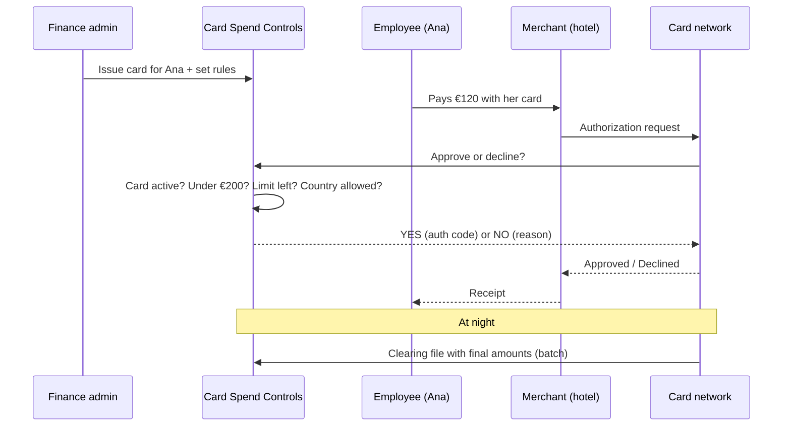

# Card Spend Controls

**Company cards with rules.** Every employee gets their own card, and every payment is
approved or declined in real time against the limits the finance team sets.

> 🚧 **In progress.** Java 25 · Spring Boot 4 · Spring Modulith · Spring Batch · Angular 22. See the [roadmap](#roadmap).

---

## The problem

Many small companies have **one card shared by everyone**. It sits in a drawer, its number is saved
on Booking and Amazon, and a photo of it gets passed around in chats. At the end of the month the
statement looks like this:

```
05 Oct   Amazon           €89
05 Oct   Restaurant Mar   €156
07 Oct   Booking.com      €340
```

It shows **where** and **how much**, but **not who**. Finance spends days chasing people and receipts.
Everyone shares one limit. And if someone loses the card, the bank blocks it, and nobody in the company can pay anymore.

## The solution

**One virtual card per employee**, each with its own rules:

| Card | Rules |
|------|-------|
| Ana (sales) | max €200 per payment · €1,000 per month · only PT, ES, FR |
| João (IT) | software shops only |
| Intern | max €50 per payment |

Every payment shows who made it. The rules are checked **before** the money leaves.
If Ana loses her card, finance freezes **only Ana's card**. Everyone else can still pay.

## How a payment works

Ana pays **€120 at a hotel**:



The hotel never calls this service directly. The **card network** knows from the card number
which company issued the card, and asks it: *"yes or no?"*. It all takes about a second.

| Situation | Answer |
|-----------|--------|
| €120 hotel, all rules OK | ✅ approved, €120 **reserved** |
| €350 laptop | ❌ `OVER_TRANSACTION_LIMIT` |
| Card frozen after it was lost | ❌ `CARD_FROZEN` |
| The network sends the same request twice | Same answer as the first time, **never charged twice** |
| Two payments at the same second, only room for one | **Exactly one** approved |

## The rules

These are the rules the service must always follow. Each one has its own test.

| # | Rule | Example |
|---|------|---------|
| R1 | A **frozen or cancelled** card is always declined | Ana lost her card and finance froze it → any payment: ❌ `CARD_FROZEN` |
| R2 | A payment **above the per-payment limit** is declined | Limit €200, laptop €350 → ❌ `OVER_TRANSACTION_LIMIT` |
| R3 | The **daily and monthly limits** count money already reserved or spent. Expired reservations don't count | Monthly limit €1,000, already €950 used, dinner €80 → ❌ `OVER_MONTHLY_LIMIT` |
| R4 | The **same request twice** gets the same answer, and is never approved twice | The network resends the €45 lunch request → same "yes", Ana pays €45, not €90 |
| R5 | **Two payments at the same second** can't go over the limit together | €200 left, dinner €200 and taxi €200 at the same moment → only one approved |
| R6 | If the **final amount is lower**, the difference goes back to the limit | Hotel reserved €120, final bill €98 → €22 back |
| R7 | **Every answer is saved**, yes or no, with the reason | Finance can see that the laptop was declined, and why |
| R8 | Money is always **exact** (`BigDecimal`, never `double`) | 0.10 + 0.20 must be exactly 0.30 |

Other declines: `BLOCKED_MERCHANT_CATEGORY` (for example a betting site), `COUNTRY_NOT_ALLOWED`,
`UNKNOWN_CARD`. A decline is a normal answer, not an error: the network always gets a yes or a no.

## At night: the batch

During the day the service only **reserves** money. The **final** amounts arrive at night in one
file from the card network. The hotel reserved €120, but Ana's final bill was €98:

```csv
networkTransactionId,capturedAmount,currency,captureDate
nt-hotel-001,98.00,EUR,2026-10-27
```

A **Spring Batch** job reads the file line by line:

- **Match found:** save the final amount. The unused €22 goes back to Ana's limit.
- **No match:** report it to finance to check.
- **Broken line:** skip it and report it, without stopping the job.

**Second job: free money that is stuck.** Ana rents a car, and the rental company **reserves €300**
as a deposit. She returns the car with no damage, so the company never takes the money and never
sends a final amount. Without this job, those €300 stay blocked on Ana's limit forever.

Every night, the job finds reservations **older than 7 days** with no final amount, marks them
`EXPIRED`, and gives the money back to the limit:

| Reservation | Age | Final amount received? | Result |
|-------------|-----|------------------------|--------|
| Car rental €300 | 8 days | No | `EXPIRED`, €300 back to Ana's limit |
| Hotel €120 | 1 day | Yes (€98) | Already done by the first job |
| Taxi €25 | 2 days | Not yet | Wait, it's still too early |

Spring Batch matters because real files have **millions** of lines. If a run crashes, it
**restarts where it stopped**, not from line 1.

## Architecture

One application split into modules (**Spring Modulith**). The modules talk through **events**,
and a test checks that they don't break their boundaries.

`cards` · `authorization` · `transactions` · `clearing` (batch) · `notifications`

## Tech stack

**Java 25** (records, sealed types, pattern matching, virtual threads) · **Spring Boot 4.1** ·
**Spring Modulith** · **Spring Batch** · **H2** locally, **PostgreSQL** for concurrency tests ·
**Flyway** · **Angular 22** · JUnit 5 · GitHub Actions

## Run it

Requires Java 25.

```bash
./mvnw spring-boot:run          # API on http://localhost:8080
```

Simulate a payment (you play the card network):

```bash
curl -X POST localhost:8080/network/authorizations -H 'Content-Type: application/json' -d '{
  "networkTransactionId": "nt-hotel-001", "cardId": "<card id>",
  "amount": 120.00, "currency": "EUR",
  "merchantName": "Hotel Lisboa", "merchantCategoryCode": "7011", "country": "PT" }'
```


**Mykhaylo Teplytskyy**, Java / Spring / Angular developer · [LinkedIn](https://www.linkedin.com/in/mykhaylo-teplytskyy)